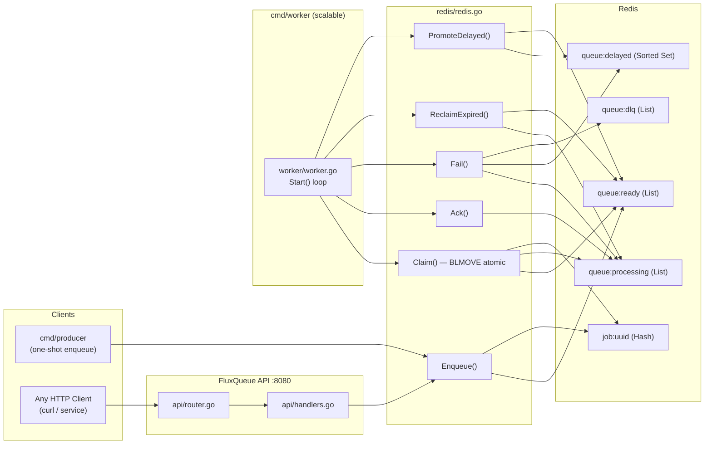
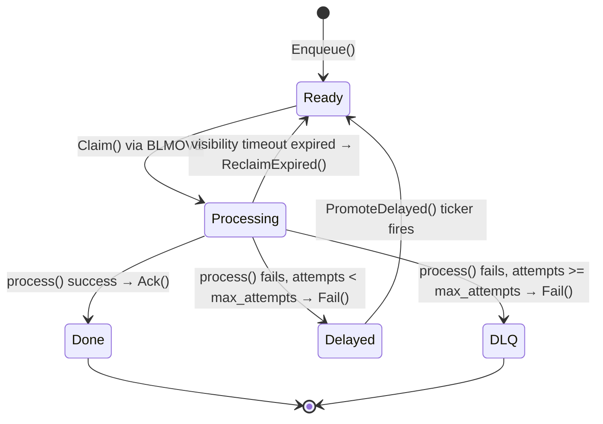

# FluxQueue

> **A distributed background job queue engine written in Go** — built to understand and replicate the real failure modes of production task queues (SQS, Sidekiq, Celery, internal task systems).

**TL;DR:** Redis-backed job queue with atomic claims, visibility timeouts, delayed retries, DLQ, and an HTTP API. Run with `docker compose up --build`.

---

## Table of Contents

- [What Is FluxQueue?](#what-is-fluxqueue)
- [Features](#features)
- [Architecture](#architecture)
- [Redis Data Model](#redis-data-model)
- [Job Lifecycle](#job-lifecycle)
- [Failure Handling & Retry](#failure-handling--retry)
- [Project Structure](#project-structure)
- [Quick Start](#quick-start)
- [API Reference](#api-reference)
- [Configuration](#configuration)
- [Design Decisions](#design-decisions)
- [Roadmap](#roadmap)

---

## What Is FluxQueue?

FluxQueue is a **self-contained, Redis-backed job queue** with:

- An **HTTP API** (Gin) to enqueue jobs from any service
- **Workers** that claim, process, and acknowledge jobs
- **Exponential backoff retries** with jitter on failure
- A **Dead Letter Queue (DLQ)** for permanently failed jobs
- **Visibility timeouts** that protect against silent worker crashes
- A **delayed job scheduler** that promotes retried jobs back to the ready queue

It is designed as a portfolio/learning project, but mirrors the architecture of real production systems.

---

## Features

| Feature | Status |
| --- | --- |
| At-least-once delivery with ACK | ✅ |
| Atomic claim via `BLMOVE` | ✅ |
| Exponential backoff retries with jitter | ✅ |
| Dead Letter Queue (DLQ) after max attempts | ✅ |
| Visibility timeout + expired job reclaim | ✅ |
| Delayed job promotion (sorted set scheduler) | ✅ |
| HTTP API to enqueue jobs (Gin) | ✅ |
| Docker Compose multi-service setup | ✅ |
| Graceful worker shutdown (SIGTERM / SIGINT) | ✅ |
| Horizontal scaling via `--scale worker=N` | ✅ |
| Priority queues | 🔜 |
| Prometheus metrics | 🔜 |
| gRPC API | 🔜 |

---

## Architecture

```
                        ┌─────────────────────────────────┐
                        │         Producer / Client        │
                        │  (HTTP POST /jobs  or  cmd/producer) │
                        └──────────────┬──────────────────┘
                                       │  JSON over HTTP
                                       ▼
                        ┌─────────────────────────────────┐
                        │         FluxQueue API            │
                        │    Gin HTTP server :8080         │
                        │   POST /jobs  →  Enqueue()       │
                        └──────────────┬──────────────────┘
                                       │  LPUSH queue:ready
                                       ▼
                   ┌───────────────────────────────────────────┐
                   │                   Redis                    │
                   │                                           │
                   │  queue:ready      (List — LPUSH + BLMOVE)  │
                   │  queue:processing (List  – in-flight jobs) │
                   │  queue:delayed    (Sorted Set – retries)   │
                   │  queue:dlq        (List  – dead letters)   │
                   │  job:<uuid>       (Hash  – job metadata)   │
                   └──────────┬──────────────┬─────────────────┘
                              │              │
               ┌──────────────┘              └──────────────┐
               ▼                                            ▼
  ┌─────────────────────┐                   ┌─────────────────────┐
  │      Worker 1        │                   │      Worker N        │
  │                      │                   │                      │
  │  Claim → Process     │  ···  (scale)  ·· │  Claim → Process     │
  │  Ack  / Fail         │                   │  Ack  / Fail         │
  │  ┌──────────────┐    │                   │  ┌──────────────┐    │
  │  │ Ticker (10s) │    │                   │  │ Ticker (10s) │    │
  │  │ ReclaimExpired│   │                   │  │ ReclaimExpired│   │
  │  │ PromoteDelayed│   │                   │  │ PromoteDelayed│   │
  │  └──────────────┘    │                   │  └──────────────┘    │
  └─────────────────────┘                   └─────────────────────┘
```

### Component Map



---

## Redis Data Model

| Key | Type | Purpose |
| --- | --- | --- |
| `queue:ready` | List | Jobs ready to be claimed by a worker |
| `queue:processing` | List | Jobs currently held by a worker (in-flight) |
| `queue:delayed` | Sorted Set | Failed jobs waiting for their retry window; score = Unix timestamp of when they become ready |
| `queue:dlq` | List | Permanently failed jobs (exceeded `max_attempts`) |
| `job:<uuid>` | Hash | Full job metadata (id, type, payload, attempts, max\_attempts, created\_at, claimed\_at) |

### Job Hash Fields

```
id           → UUID string
type         → job type string (e.g. "echo", "send-email")
payload      → arbitrary bytes / JSON string
attempts     → current attempt count
max_attempts → cap (default 3)
created_at   → RFC3339 timestamp
claimed_at   → RFC3339 timestamp set when a worker claims the job
```

---

## Job Lifecycle



**State descriptions:**

- **Ready** — job sits in `queue:ready`, waiting for a free worker
- **Processing** — atomically moved to `queue:processing` via `BLMOVE`; a `claimed_at` timestamp is written to the job hash
- **Done** — `Ack()` removes from `queue:processing` and deletes the job hash
- **Delayed** — `Fail()` writes the job ID to `queue:delayed` with a score of `now + backoff_delay`
- **DLQ** — after all retries exhausted, job ID is `LPUSH`-ed to `queue:dlq` for manual inspection
- **Reclaimed** — if a worker crashes mid-job, the next `ReclaimExpired()` tick moves the job back to `queue:ready`

---

## Failure Handling & Retry

### Exponential Backoff Formula

```
delay = (2^(attempt-1)) × 5 seconds  +  rand(0, 25) seconds jitter
cap   = 80 seconds
```

| Attempt | Base Delay | With Max Jitter |
| --- | --- | --- |
| 1 | 5s | up to 30s |
| 2 | 10s | up to 35s |
| 3 | 20s | up to 45s |

When `attempts >= max_attempts` the job is moved to **`queue:dlq`** instead of `queue:delayed`.

### Visibility Timeout / Worker Crash Recovery

Every worker runs a **10-second background ticker** that calls:

1. `ReclaimExpired()` — scans `queue:processing`, finds jobs where `claimed_at` is older than `visibilityTimeout` (default **10s**), and moves them back to `queue:ready`.
2. `PromoteDelayed()` — checks `queue:delayed` for jobs whose score ≤ `now` and moves them to `queue:ready`.

This means **no job is ever permanently stuck** even if a worker process dies unexpectedly.

```
Worker crash scenario:
  Job claimed → claimed_at stamped
  Worker dies (no Ack, no Fail)
  10 seconds later → ReclaimExpired() fires on another worker
  Job moves: queue:processing → queue:ready
  Job re-claimed by any available worker ✓
```

---

## Project Structure

```
fluxqueue/
├── cmd/
│   ├── api/
│   │   └── main.go          # Starts the Gin HTTP server
│   ├── worker/
│   │   └── main.go          # Starts one worker process (scale with Docker Compose)
│   └── producer/
│       └── main.go          # One-shot job enqueuer (for testing)
│
├── api/
│   ├── router.go            # Route registration (GET /health, POST /jobs)
│   └── handlers.go          # HTTP handler logic
│
├── job/
│   └── job.go               # Job struct definition
│
├── redis/
│   └── redis.go             # All Redis operations (Enqueue, Claim, Ack, Fail, ...)
│
├── worker/
│   └── worker.go            # Worker loop: claim → process → ack/fail + ticker
│
├── Dockerfile               # Multi-stage build (builder / worker-runtime / api-runtime)
├── docker-compose.yml       # Redis + API + Worker services
├── go.mod
└── README.md
```

---

## Quick Start

### Prerequisites

- **Go 1.27+** (see `go.mod`)
- **Docker & Docker Compose** (for the full stack)

### Option A — Docker Compose (recommended)

```bash
# Clone
git clone https://github.com/Shreyas9468/FluxQueue.git
cd FluxQueue

# Start Redis + API + 1 Worker
docker compose up --build

# Scale to multiple workers
docker compose up --build --scale worker=3
```

### Option B — Run locally

```bash
# Terminal 1 – Redis
docker run -p 6379:6379 redis:7-alpine

# Terminal 2 – API server
REDIS_ADDR=localhost:6379 go run ./cmd/api

# Terminal 3 – Worker
REDIS_ADDR=localhost:6379 go run ./cmd/worker

# Terminal 4 – Enqueue a test job via HTTP
curl -s -X POST http://localhost:8080/jobs \
  -H "Content-Type: application/json" \
  -d '{"type":"echo","payload":"{\"msg\":\"hello\"}"}'

# Verify it was processed — watch the worker terminal for:
# "Claimed job <id>"  →  "processing job <id> | payload: ..."  →  "Acked job <id>"

# Or use the producer binary
go run ./cmd/producer
```

---

## API Reference

### `GET /health`

Health check.

**Response `200 OK`**

```json
{ "status": "ok" }
```

---

### `POST /jobs`

Enqueue a new job.

**Request body**

```json
{
  "type": "echo",
  "payload": "{\"to\":\"user@example.com\"}"
}
```

| Field | Type | Required | Description |
| --- | --- | --- | --- |
| `type` | string | ✅ | Job type — matched in `worker.process()` switch |
| `payload` | string | ❌ | Arbitrary string or JSON payload |

**Response `201 Created`**

```json
{ "id": "550e8400-e29b-41d4-a716-446655440000" }
```

**Response `400 Bad Request`** — missing required fields

**Response `500 Internal Server Error`** — Redis write failed

---

### Currently Supported Job Types

| Type | Behaviour |
| --- | --- |
| `echo` | Logs the payload and succeeds |
| `fail` | Always returns an error (triggers retry/DLQ path) |
| anything else | Returns "unknown job type" error |

---

## Configuration

All configuration is via **environment variables**:

| Variable | Default | Description |
| --- | --- | --- |
| `REDIS_ADDR` | `localhost:6379` | Redis server address |
| `HTTP_ADDR` | `:8080` | API server listen address |

Visibility timeout is currently hardcoded to **10 seconds** in `cmd/worker/main.go`.

---

## Design Decisions

| Decision | Choice | Reasoning |
| --- | --- | --- |
| **Backing store** | Redis | Fast in-memory ops; `List` is perfect for FIFO queues; `Sorted Set` is perfect for delayed jobs by score (Unix timestamp) |
| **Claim atomicity** | `BLMOVE` | Single atomic command: pops from `queue:ready` and pushes to `queue:processing` — no race condition possible |
| **Delivery guarantee** | At-least-once | Simpler and practical for most background jobs; requires idempotent handlers |
| **Retry strategy** | Exponential backoff + jitter | Avoids thundering herd when many jobs fail simultaneously |
| **Crash recovery** | Visibility timeout + ticker | Workers stamp `claimed_at`; a background ticker reclaims stale jobs — no coordinator needed |
| **HTTP framework** | Gin | Lightweight, fast; good learning exercise; handles JSON binding and routing cleanly |
| **Multi-binary** | `cmd/api`, `cmd/worker`, `cmd/producer` | Separation of concerns; each binary can be independently scaled in Docker Compose |
| **Metadata storage** | Redis Hash per job | Allows O(1) field reads without deserializing the full payload on every operation |
| **Why not Redis Streams?** | Lists + `BLMOVE` | Streams were considered; Lists + `BLMOVE` give a clearer reliable-queue mental model and simpler reclaim logic for this project |

---

## Roadmap

- [ ] Priority queues (`queue:high`, `queue:normal`, `queue:low`)
- [ ] Prometheus metrics (`/metrics` endpoint)
- [ ] DLQ inspection API (`GET /dlq`, `POST /dlq/:id/retry`)
- [ ] gRPC API alongside HTTP
- [ ] Configurable max attempts and visibility timeout per job
- [ ] Job cancellation
- [ ] Web dashboard (job status, DLQ browser)
